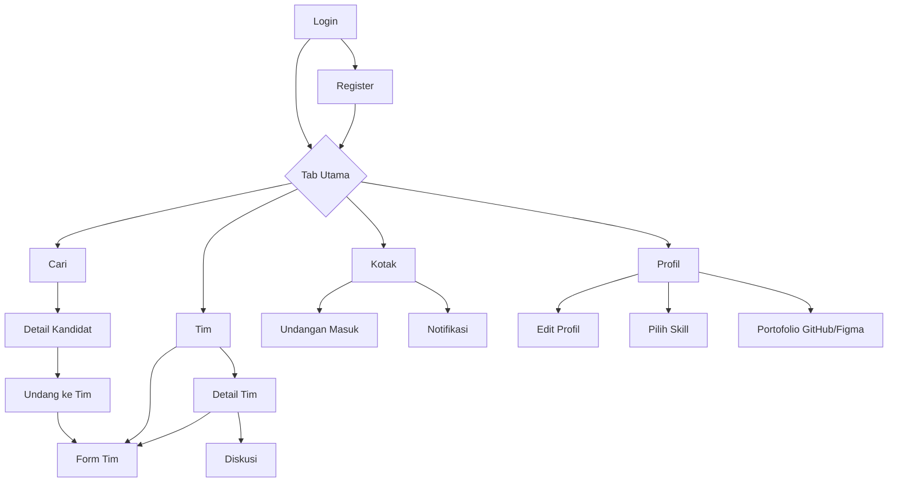
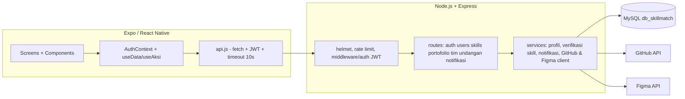
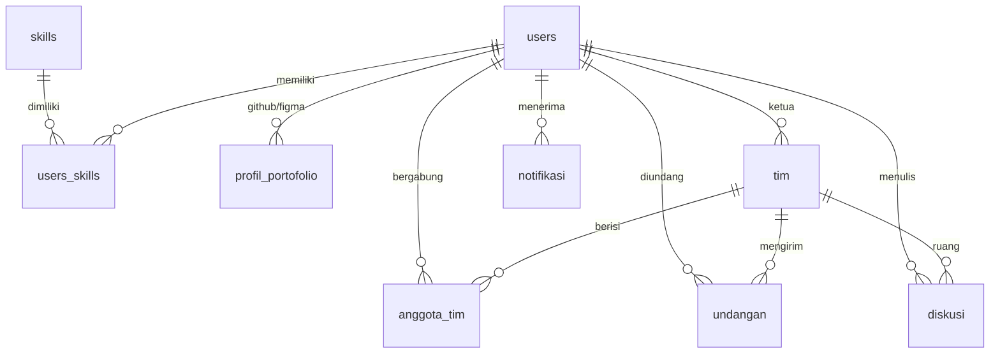
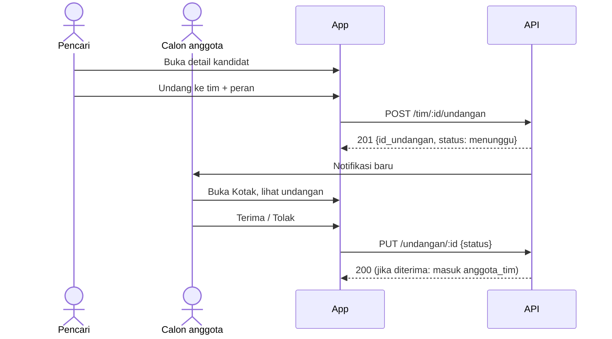
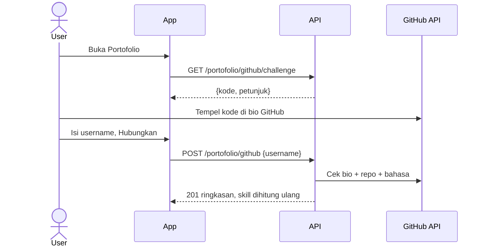

# SkillMatch — Design Document (design.md)

**Versi:** 0.1 — Draft untuk validasi kelompok
**Proyek:** Pemrograman Mobile (SIF125113), Kelompok 4, Kelas H6C.3
**Platform:** React Native (Expo); target akhir (Android saja atau Android + iOS) **belum ditetapkan**, lihat 1.1 · **Backend:** Node.js + Express + MySQL
**Sumber:** Dokumen Analisis Kebutuhan PjBL Tahap 1 (PDF), PRD_SkillMatch.md, dan dokumen kode (backend `api-skillmatch` + mobile `skillmatch-mobile`).

> Dokumen ini menggabungkan **desain UI/UX**, **desain sistem**, dan **desain teknis mobile**.
> Arti tanda:
> - **[Ada di kode]** = terlihat pada dokumen kode yang diberikan. Ini **belum berarti** sudah diuji berjalan di perangkat kelompok.
> - **[Usulan]** = rekomendasi desain, belum diterapkan.
> - **[Perlu dicek]** = sumber tidak konsisten atau bagian kode belum terlihat; jangan dianggap final.
> - **[Belum disepakati]** = keputusan kelompok masih terbuka.

---

## 1. Ringkasan Desain

SkillMatch membantu mahasiswa menemukan rekan tim berdasarkan **peran, skill, ketersediaan, dan bukti portofolio** (GitHub/Figma), lalu mengelola **undangan, tim, dan diskusi** di satu tempat.

| Masalah (PDF) | Modul | Prinsip desain yang menjawab |
|---|---|---|
| **M1** Sulit menemukan rekan dengan skill sesuai | Pencarian & filter kandidat, profil, skill | Terarah: filter jelas, hasil ringkas, kartu mudah dipindai |
| **M2** Klaim skill hanya self-claim | Verifikasi portofolio GitHub/Figma | Berbasis bukti: bukti selalu dibedakan dari klaim |
| **M3** Koordinasi tim tercecer di grup chat | Tim, undangan, diskusi | Terpusat: status eksplisit, satu ruang diskusi per tim |

**Prinsip UI** (dari PRD): jelas, terarah, berbasis bukti, konsisten, memberi kendali ke pengguna, tanggap terhadap jaringan, menjaga privasi.

### 1.1 Status Fitur dan Keputusan Terbuka

Tabel ini menjadi acuan agar dokumen tidak menyatakan sesuatu sudah final padahal belum disepakati atau diuji.

| Topik | Posisi sumber | Status di dokumen ini | Tindakan |
|---|---|---|---|
| **Bookmark kandidat** (FR-13, US-08) | PRD: perlu konfirmasi. PDF: *Could*. Backend: tidak ada tabel/endpoint dan README menyebut *Won't* | **Bukan fitur final.** Tidak ada layar bookmark pada desain ini | Kelompok memutuskan: batal (perbarui PDF/PRD) atau masuk (butuh tabel `bookmarks`, endpoint, dan UI) |
| **Notifikasi** (FR-12, US-10) | PRD: perlu konfirmasi. PDF: *Could* | **Ada di kode, wajib/tambahan [Belum disepakati].** Didesain sebagai fitur tambahan. Cakupan nyata: jenis `undangan_tim` dan `kandidat_cocok` (dipicu saat skill diubah), tandai dibaca; **tanpa polling** di mobile | Putuskan status wajib atau tambahan; uji di perangkat (6.7) |
| **Model data** | PRD: 11 entitas. PDF: `PROFIL_GITHUB` + `PROFIL_FIGMA` + `BOOKMARKS`. Kode: 9 tabel | **`schema.sql` menjadi acuan implementasi** (lihat 8.2) | Perbarui PRD/PDF agar sama dengan skema |
| **Navigasi** | PDF: React Navigation. `AGENTS.md`: Expo Router. Layar: menerima props `navigation`/`route` | **[Perlu dicek]** Rancangan 3.2 tetap usulan | Periksa file navigator/`App.js` pada repo sebelum menetapkan (lihat 3.3) |
| **Cache offline** | PRD: cache jika tersedia. README: ada di aplikasi | **Belum terbukti.** Ada indikasi (`d.stale`, `useData(key)`), tetapi `hooks.js` tidak terlihat dan tidak ada `AsyncStorage` di kode. Hanya timeout, pesan galat, dan retry yang pasti ada (9.1) | Baca `hooks.js`, uji mode offline. Sebelum lolos uji, tulis sebagai rekomendasi |
| **Platform** | Ruang lingkup PDF: Android API 26. Tabel 6.1 PDF: "Android / iOS / Keduanya", iOS 13 | **[Belum disepakati]** Desain ini netral platform, diuji dengan asumsi Android | Kelompok menetapkan satu target dan memperbarui PDF |
| **Figma** (FR-07, US-03) | PRD: perlu verifikasi | **Ada di kode (backend + layar), belum diuji.** Tidak boleh disebut selesai | Uji dengan token dan file key nyata (6.9) |

---

## 2. Persona & Konteks

| Persona | Kebutuhan | Layar utama |
|---|---|---|
| **Pencari tim** | Menemukan kandidat sesuai skill/peran, meninjau bukti, mengundang | Cari, Detail Kandidat, Undang |
| **Calon anggota** | Profil menarik, skill, portofolio, merespons undangan | Profil, Pilih Skill, Portofolio, Undangan |
| **Anggota tim** | Melihat komposisi tim, berdiskusi | Tim, Detail Tim, Diskusi |

**Konteks:** mobile-first, dipakai di kampus/kos/perjalanan; jaringan **stabil atau terbatas**, sehingga setiap layar data wajib punya loading, error, retry, dan (bila ada) cache.

---

## 3. Arsitektur Informasi & Navigasi

### 3.1 Peta layar

Daftar layar berasal dari `src/screens/` **[Ada di kode]**. Pengelompokan tab adalah **[Usulan]**.



### 3.2 Tab bar [Usulan]

| Tab | Isi | Badge |
|---|---|---|
| **Cari** | Pencarian & filter kandidat | – |
| **Tim** | Daftar tim saya | – |
| **Kotak** | Sub-tab Undangan + Notifikasi | [Usulan] Jumlah undangan menunggu / notifikasi belum dibaca. `api.js` saat ini hanya mengembalikan body (header `X-Belum-Dibaca` tidak terbaca), jadi hitung dari daftar atau ubah `api.js` |
| **Profil** | Profil sendiri | – |

### 3.3 [Perlu dicek] Pustaka navigasi
Bukti yang ada:
- Dokumen analisis (6.1) memilih **React Navigation**.
- Layar pada `src/screens/` menerima props `navigation` dan `route` dan memanggil `navigation.navigate(...)`, yang merupakan pola React Navigation (Expo Router memakai `router`/`useLocalSearchParams`).
- `AGENTS.md` menyebut Expo Router, tetapi berkas itu terlihat seperti panduan bawaan template Expo.
- Berkas navigator (`App.js` atau `src/app/_layout`) **tidak ada** pada dokumen kode yang diterima.

Kesimpulan sementara: kemungkinan besar React Navigation, **tetapi belum terverifikasi**. Sebelum rancangan tab/stack di 3.1–3.2 dianggap final, periksa struktur folder repo (`src/app/` ada atau tidak) dan `package.json` (`@react-navigation/*` atau `expo-router`).

---

## 4. Sistem Visual

### 4.1 Palet warna

Hanya tiga warna utama dari arahan pengguna. **`#F7F0E6` tidak digunakan.** Putih/hitam netral hanya untuk keterbacaan.

| Token | Hex | Peran |
|---|---|---|
| `burgundy` | `#681B25` | Warna merek, header, tombol utama, teks judul, state aktif |
| `beige` | `#A78E75` | Aksen, border, ikon, divider, tombol sekunder (garis) |
| `cream` | `#E2D0B0` | Latar layar, chip tidak aktif, teks di atas burgundy |
| `white` | `#FFFFFF` | Permukaan kartu & input (netral) |
| `ink` | `#1A1A1A` | Teks isi di atas putih/cream (netral) |

**Aturan kontras (perkiraan rasio WCAG):**

| Kombinasi | Rasio | Penggunaan |
|---|---|---|
| Burgundy di atas cream | ± 7,8 : 1 | Aman untuk semua teks |
| Cream di atas burgundy | ± 7,8 : 1 | Teks tombol utama, header |
| Burgundy di atas putih | ± 12 : 1 | Aman |
| Beige di atas burgundy | ± 3,8 : 1 | Hanya teks besar (≥ 18 pt) / ikon |
| Beige di atas putih | ± 3,1 : 1 | **Jangan untuk teks isi**; hanya border/ikon/dekorasi |

> Verifikasi ulang rasio dengan alat kontras sebelum finalisasi.

**Status undangan** (tanpa menambah warna baru; jangan hanya mengandalkan warna, selalu sertakan ikon + label):

| Status | Tampilan |
|---|---|
| `menunggu` | Chip outline beige, ikon jam, label "Menunggu" |
| `diterima` | Chip burgundy terisi, ikon centang, label "Diterima" |
| `ditolak` | Chip outline burgundy, ikon silang, label "Ditolak" |

**Catatan error:** pesan galat memakai kartu putih dengan border + ikon burgundy dan teks jelas, bukan warna merah baru.

### 4.2 Tipografi

Font yang dipakai bisa disesuaikan dengan `expo-font`; usulan gaya elegan namun terbaca:

| Peran | Font | Ukuran / berat |
|---|---|---|
| Judul layar & nama | **Playfair Display** (serif, kesan mewah) | 24 / 700 |
| Sub-judul kartu | Inter | 16 / 600 |
| Isi | Inter | 14–15 / 400, line-height 1,5 |
| Caption, tanggal | Inter | 12 / 400 |
| Tombol, chip | Inter | 14 / 600 |

Fallback: font sistem Android. Minimum teks isi 14 sp.

### 4.3 Spasi, sudut, elevasi

| Token | Nilai |
|---|---|
| Spasi dasar | 4 · 8 · 12 · 16 · 24 · 32 |
| Padding layar | 16 |
| Radius | kartu 16 · tombol 12 · chip 999 (pil) · input 12 |
| Elevasi kartu | bayangan lembut (burgundy opasitas 8–10%), atau border 1 px beige |
| Target sentuh | minimal 48 × 48 dp |

### 4.4 Token tema (React Native) [Usulan]

Kode saat ini mengimpor `s` dari `../theme`. Berikut usulan isi token:

```js
// src/theme.js
export const warna = {
  burgundy: '#681B25',
  beige:    '#A78E75',
  cream:    '#E2D0B0',
  putih:    '#FFFFFF',
  teks:     '#1A1A1A',
};

export const spasi = { xs: 4, sm: 8, md: 12, lg: 16, xl: 24, xxl: 32 };
export const radius = { kartu: 16, tombol: 12, chip: 999, input: 12 };
```

### 4.5 Ikonografi & ilustrasi
- Ikon garis tipis konsisten (misalnya `@expo/vector-icons` Feather/Ionicons), warna burgundy/beige.
- Avatar: lingkaran dengan inisial nama, latar beige, teks burgundy (karena tidak ada foto di skema).
- Empty state: ilustrasi sederhana satu warna beige + kalimat ajakan.

---

## 5. Komponen UI

Komponen sudah ada di `src/components` **[Ada di kode]**: `Halaman`, `Kartu`, `Tombol`, `Chip`, `SkillChips`, `Status`, `Galat`, `Input`. Berikut spesifikasi visualnya.

| Komponen | Spesifikasi |
|---|---|
| **Halaman** | Latar cream, padding 16, mendukung pull-to-refresh (`onRefresh`, `refreshing`) |
| **Kartu** | Putih, radius 16, border 1 px beige, tekan = ripple ringan |
| **Tombol** (utama) | Isi burgundy, teks cream, tinggi 48, radius 12 |
| **Tombol** `variant="garis"` | Transparan, border 1,5 px burgundy, teks burgundy |
| **Tombol** disabled/busy | Opasitas 50% + indikator loading; cegah tekan ganda |
| **Chip** | Pil; nonaktif = cream + border beige, aktif = burgundy + teks cream |
| **SkillChips** | Deretan chip kecil, maks 6 lalu "+N"; skill terverifikasi diberi ikon ✓ |
| **Status** | Chip status undangan (lihat 4.1) |
| **Galat** | Kartu pesan + tombol "Coba lagi" |
| **Input** | Putih, border beige, fokus border burgundy, label di atas, pesan validasi di bawah |
| **Banner** | Strip tipis di atas layar untuk info jaringan/gagal polling |

### 5.1 Kartu kandidat

```
┌─────────────────────────────────────┐
│ (AB)  Andi Pratama        ● Tersedia│
│       Developer                     │
│ [JavaScript ✓] [React Native ✓]     │
│ [Node.js ✓] [+2]                    │
│ GitHub: 12 repo · 340 commit        │
└─────────────────────────────────────┘
```

### 5.2 Lencana bukti vs klaim (inti M2)

| Jenis | Tampilan | Arti |
|---|---|---|
| Skill **terverifikasi** | Chip burgundy + ✓ | `status_verifikasi = terverifikasi` (bahasa ada di repo GitHub / file Figma terbaca) |
| Skill **belum** diverifikasi | Chip outline beige | Klaim pengguna |
| Ringkasan portofolio | Kartu terpisah berjudul "Bukti portofolio" | Data otomatis dari API, bukan tulisan pengguna |

> Jangan menulis "terverifikasi" melebihi aturan backend: pemrograman = bahasa ada di repo GitHub; desain = ada file Figma yang bisa diakses.

---

## 6. Desain Layar

Wireframe kasar; detail visual mengikuti Bagian 4.

### 6.1 Login & Register (FR-01)
- Logo/nama **SkillMatch** (serif, burgundy) di atas latar cream.
- Login: email, password (dengan tombol tampil/sembunyi), tombol **Masuk**, tautan "Belum punya akun? Daftar".
- Register: nama, email, password, pilihan **peran utama** (Developer / Desainer / Lainnya) memakai `Chip`.
- Validasi di bawah input; galat server lewat `Galat`. Password/token tidak pernah ditampilkan.

### 6.2 Cari (FR-04) — `GET /users/search`

```
┌ Cari rekan tim ─────────────────────┐
│ [🔍 Cari nama / kata kunci   ] [⚙]  │
│ Peran: (Semua)(Developer)(Desainer) │
│ (Hanya yang tersedia) (Skill ✓)     │
│ Skill: (Figma)(JavaScript)(…)       │
│ [ Terapkan ]  [ Reset ]             │
├─────────────────────────────────────┤
│ 24 kandidat                         │
│ [Kartu kandidat]                    │
│ [Kartu kandidat]                    │
└─────────────────────────────────────┘
```

Filter yang **didukung backend** [Ada di kode]: `q`, `peran`, `tersedia`, `verified`, `skill` (dipisah koma), `page`, `limit`. Total hasil di header `X-Total-Count`.

State: loading (skeleton kartu), kosong ("Tidak ada kandidat yang cocok. Coba longgarkan filter." + tombol Reset), galat (`Galat` + coba lagi).

### 6.3 Detail Kandidat (FR-05, FR-06, FR-07) — `GET /users/:id`
Urutan konten: header (avatar, nama, peran, ketersediaan) → bio → **Skill** (chip dengan status verifikasi) → **Bukti portofolio** (GitHub: jumlah repo, jumlah commit, bahasa teratas; Figma: jumlah proyek, daftar file) → tombol **Undang ke tim**.
- Email **tidak** ditampilkan (privasi, sesuai backend).
- Jika portofolio belum terhubung: "Belum ada portofolio terhubung" (404 ditangani sebagai kondisi normal).

### 6.4 Undang ke Tim (FR-10) — `POST /tim/:id/undangan`
- Pilih tim (daftar tim milik pengguna) dan **peran ditawarkan**.
- Jika belum punya tim: ajakan "Buat tim dulu" → Form Tim.
- 409 (duplikat) ditampilkan sebagai pesan ramah.

### 6.5 Tim (FR-08, FR-09)
- **Aturan peran di backend [Ada di kode]:** pembuat tim otomatis menjadi **Ketua**. Hanya ketua yang dapat mengubah/menghapus tim, mengundang, mengubah peran, dan mengeluarkan anggota. Anggota dapat melihat detail tim, berdiskusi, dan keluar sendiri; ketua tidak dapat keluar (harus membubarkan tim). Tidak terlihat batas jumlah anggota maupun jumlah tim per pengguna.
- **Daftar tim**: kartu berisi nama tim, `peran_saya`, `jumlah_anggota`, chip kebutuhan skill; tombol **Buat tim baru**.
- **Form tim**: nama, deskripsi, kebutuhan skill (multi-pilih chip).
- **Detail tim**: deskripsi, kebutuhan skill, daftar anggota + peran, daftar undangan terkirim (dengan status), tombol **Buka ruang diskusi**.
  - Ketua: ubah tim, ubah peran anggota, keluarkan anggota, bubarkan tim (dengan dialog konfirmasi).
  - Anggota: keluar dari tim (konfirmasi).
  - Aksi destruktif memakai konfirmasi dengan kalimat jelas ("Hapus tim beserta seluruh diskusinya?").

### 6.6 Diskusi (FR-11) — `GET/POST /tim/:id/diskusi`
- Gelembung pesan: milik sendiri di kanan (burgundy, teks cream), orang lain di kiri (putih, border beige, nama pengirim kecil).
- Input di bawah dengan tombol kirim; pesan kosong ditolak ("Pesan tidak boleh kosong").
- Polling setiap **4 detik** dengan `setelah_id` [Ada di kode]; jika gagal tampil banner "Tidak dapat memperbarui pesan".
- Urutan pesan: lama → baru, auto-scroll ke bawah saat ada pesan baru.

### 6.7 Kotak: Undangan & Notifikasi (FR-10, FR-12)
- **Undangan masuk**: kartu berisi nama tim, pengirim, peran ditawarkan, tanggal, `Status`. Untuk `menunggu`: tombol **Terima** (utama) dan **Tolak** (garis).
- **Notifikasi** (status wajib/tambahan [Belum disepakati]). Cakupan yang terlihat di kode: jenis `undangan_tim` (dikirim ke calon anggota saat diundang) dan `kandidat_cocok` (dikirim ke ketua tim saat pengguna tersedia menyimpan skill yang dibutuhkan timnya, tanpa duplikat). `kandidat_cocok` dipanggil dari `PUT /users/me/skills`, jadi hanya terpicu saat skill diperbarui; **uji** di perangkat. Mobile belum memakai polling untuk notifikasi (hanya tarik-untuk-muat-ulang). Tampilan: daftar jenis + isi + waktu; yang belum dibaca diberi penanda titik burgundy; aksi **Tandai semua dibaca**.
- Refresh via pull-to-refresh dan polling.

### 6.8 Profil, Edit Profil, Pilih Skill (FR-02, FR-03)
- **Profil**: avatar, nama, peran, bio, ketersediaan, skill + status verifikasi, tombol **Ubah profil**, **Pilih skill**, **Hubungkan GitHub / Figma**, **Keluar**.
- **Edit profil**: nama, bio, peran utama, saklar ketersediaan.
- **Pilih skill**: skill dikelompokkan per kategori (pemrograman / desain / lainnya) dari `GET /skills`, multi-pilih chip, simpan via `PUT /users/me/skills`.

### 6.9 Portofolio (M2)
- **GitHub**: petunjuk kode tantangan (`GET /portofolio/github/challenge`) untuk ditempel di bio GitHub → input username → **Hubungkan**. Setelah terhubung: ringkasan + **Sinkronkan** + **Putuskan**. Kode dapat disalin (`selectable`).
- **Figma** [Ada di kode, belum diuji]: input token + file key; **token tidak disimpan** (dipakai sekali), jelaskan ini di teks bantuan. Backend memanggil `GET /v1/me` dan `GET /v1/files/:key?depth=1`; token tidak valid → 401, tidak ada file terbaca → 422. Sebelum fitur dinyatakan selesai, uji dengan token dan file key nyata: kasus berhasil, token salah, file key salah, dan jaringan gagal. Siapkan teks bantuan cara membuat personal access token.
- Kegagalan layanan eksternal: pesan jelas + tombol **Coba lagi**; indikator loading selama proses (target jelas jika lama).

---

## 7. Pola Interaksi Lintas Layar

### 7.1 Empat keadaan wajib untuk setiap layar data

| Keadaan | Perilaku |
|---|---|
| **Loading** | Skeleton / spinner burgundy; jangan kosongkan layar jika ada data lama |
| **Kosong** | Ilustrasi + kalimat + aksi berikutnya |
| **Galat** | `Galat` dengan pesan dari `{ pesan }` backend + **Coba lagi** |
| **Berhasil** | Data tampil; aksi sukses diberi umpan balik singkat (toast/snackbar) |

### 7.2 Pesan galat jaringan (sesuai `api.js`) [Ada di kode]

| Kondisi | Pesan ke pengguna |
|---|---|
| Timeout 10 detik | "Waktu tunggu habis. Periksa data sebelum mengulang." |
| Jaringan gagal | "Tidak dapat terhubung ke server. Periksa koneksi internet." |
| 401 | Sesi dihapus, arahkan ke Login (`saatTidakSah`) |
| 400 / 403 / 404 / 409 | Tampilkan `pesan` dari backend |
| 500 | "Terjadi kesalahan pada server. Coba lagi nanti." |

### 7.3 Pencegahan aksi ganda
Semua aksi tulis memakai `useAksi` (`busy`, `error`, `jalankan`): tombol dinonaktifkan selama proses.

### 7.4 Aksesibilitas
- Target sentuh ≥ 48 dp, `accessibilityLabel` pada ikon-saja, status tidak hanya dengan warna.
- Dukung ukuran font sistem; uji layar kecil (≈ 360 dp lebar) dan besar.

---

## 8. Desain Sistem

### 8.1 Arsitektur



### 8.2 Model data (9 tabel) [Ada di kode]



**Acuan implementasi: `schema.sql`** (nama kolom, tipe, kunci, relasi). PRD dan PDF perlu mengikuti skema ini, bukan sebaliknya, sampai kelompok memutuskan perubahan.

| Item | PRD / PDF | `schema.sql` | Keterangan |
|---|---|---|---|
| Jumlah entitas | 11 | **9** | `users`, `skills`, `users_skills`, `profil_portofolio`, `tim`, `anggota_tim`, `undangan`, `diskusi`, `notifikasi` |
| Profil GitHub & Figma | `profil_github` dan `profil_figma` terpisah | Digabung jadi **`profil_portofolio`** (kolom `platform`, ringkasan JSON) | Perbedaan desain, bukan kekurangan; satu pengguna maksimal satu akun per platform |
| `bookmarks` | Ada | **Tidak ada** | Bergantung keputusan bookmark (1.1) |
| Pelacakan verifikasi skill | Tidak disebut rinci | Kolom `status_verifikasi` di `users_skills` | Mendukung lencana "terverifikasi" |

### 8.3 Kontrak API (ringkas) [Ada di kode]

| Kelompok | Endpoint utama |
|---|---|
| Auth | `POST /auth/register`, `POST /auth/login`, `GET /auth/me` |
| Profil & cari | `GET/PUT /users/me`, `PUT /users/me/skills`, `GET /users/search`, `GET /users/:id` |
| Skill | `GET /skills`, `GET /skills/statistik` |
| Portofolio | `GET /portofolio`, `GET/POST/DELETE /portofolio/github`, `GET /portofolio/github/challenge`, `POST /portofolio/github/sinkron`, `GET/POST/DELETE /portofolio/figma` |
| Tim | `POST/GET /tim`, `GET/PUT/DELETE /tim/:id`, `POST /tim/:id/undangan`, `PUT/DELETE /tim/:id/anggota/:id_users` |
| Undangan | `GET /undangan?status=`, `PUT /undangan/:id` (`diterima`/`ditolak`) |
| Diskusi | `GET/POST /tim/:id/diskusi` |
| Notifikasi | `GET /notifikasi`, `PUT /notifikasi/:id/baca`, `PUT /notifikasi/baca-semua` |

Aturan respons: GET daftar = array langsung; DELETE = 204 tanpa body; galat = `{ "pesan": "..." }`; semua endpoint kecuali `/`, `/auth/register`, `/auth/login`, `/skills*` butuh `Authorization: Bearer <token>`.

### 8.4 Diagram alur utama

**Undangan tim (M3)**



**Hubungkan GitHub (M2)**



### 8.5 Keamanan & privasi [Ada di kode]
- Password di-hash bcrypt; JWT bearer; helmet + rate limit.
- Token Figma dipakai sekali dan tidak disimpan; token GitHub opsional hanya di `.env` backend.
- Email tidak muncul pada profil publik.
- Prepared statement di semua kueri; validasi input di backend.
- UI tidak menampilkan token/kredensial. `EXPO_PUBLIC_API_URL` bukan rahasia, **jangan** menaruh secret apa pun di variabel `EXPO_PUBLIC_*`.

---

## 9. Jaringan, Cache, dan Offline

Dasar status: **dokumen kode yang diterima** (snapshot), bukan repository terbaru, dan bukan hasil uji di perangkat.

### 9.1 Terlihat di kode [Ada di kode]

| Kemampuan | Bukti |
|---|---|
| Timeout 10 detik | `api.js` (`AbortController`) |
| Pesan galat timeout, jaringan, dan 401 (logout otomatis) | `api.js` |
| Loading, galat, dan muat ulang di layar data | Komponen `Status`/`Galat`, `onRefresh` pada `FlatList`/`Halaman`, `useData(key, fetcher)` dipakai di layar Cari, Detail, Undang, Undangan, Notifikasi |
| Polling chat 4 detik + banner jika gagal | `DiskusiScreen` (satu-satunya `setInterval` pada kode mobile) |

### 9.2 Belum terbukti [Perlu dicek / diuji]

| Hal | Keadaan | Tindakan |
|---|---|---|
| **Cache offline** | Ada **indikasi**: layar memakai `d.stale` dan `useData` memakai `key`. Namun `hooks.js` tidak ada di dokumen, dan tidak ada pemakaian `AsyncStorage` di kode yang terlihat. README menyebut cache ada | Baca `hooks.js`. Uji: buka Cari, matikan jaringan, buka ulang. **Jangan disebut fitur sudah diterapkan** sebelum lolos uji |
| **Polling notifikasi/undangan** | README menyebut polling, tetapi pada kode mobile hanya Diskusi yang memakai polling. Notifikasi/Undangan diperbarui lewat tarik-untuk-muat-ulang dan `d.reload()` | Pilih: tambah polling atau tulis "manual refresh" |
| **Sinkronisasi saat koneksi pulih** | Tidak terlihat | Rekomendasi |
| **Kinerja ≤ ± 3 detik** | Target dari PDF | Ukur saat pengujian |

### 9.3 Rancangan cache yang disarankan [Usulan]
`useData(key, fetcher)` menyimpan hasil terakhir per `key` di AsyncStorage; saat gagal jaringan tampil data lama + banner "Menampilkan data tersimpan"; muat ulang otomatis saat koneksi pulih. Hanya GET yang di-cache (profil, hasil cari terakhir, undangan, detail tim). Token disimpan di `expo-secure-store`.

---

## 10. Keselarasan Kebutuhan ↔ Desain ↔ Kode

**Cara membaca.** Status diperiksa pada isi kode: route backend, layar mobile, dan pemanggil di `api.js`, bukan hanya daftar file atau README. Kolom **Teruji** diisi "Belum" karena hasil uji (`test/api.test.js`, koleksi Postman, uji perangkat) tidak ada di dokumen. Karena yang tersedia adalah snapshot, cocokkan ulang dengan repository terbaru sebelum final.

| ID | Fitur | Backend (kode) | Mobile (kode) | Teruji | Catatan |
|---|---|---|---|---|---|
| FR-01 | Registrasi/login | `POST /auth/register`, `/auth/login`, `GET /auth/me` | `LoginScreen`, `RegisterScreen`, `api.login/register/me`, logout otomatis saat 401 | Belum | – |
| FR-02 | Profil | `GET/PUT /users/me` | `ProfilScreen`, `EditProfilScreen` | Belum | – |
| FR-03 | Skill | `GET /skills`, `PUT /users/me/skills` | `PilihSkillScreen` | Belum | Mengubah skill menghitung ulang verifikasi dan memicu notifikasi `kandidat_cocok` |
| FR-04 | Cari & filter | `GET /users/search` (`q`, `peran`, `tersedia`, `verified`, `skill`, `page`, `limit`) | `CariScreen` mengirim `q`, `peran`, `tersedia`, `verified`, `skill`, `limit: 30` | Belum | `page` belum dipakai mobile; total (`X-Total-Count`) tidak dibaca (`api.js` hanya mengembalikan body) |
| FR-05 | Detail kandidat | `GET /users/:id` | `KandidatDetailScreen` | Belum | – |
| FR-06 | Portofolio GitHub | `/portofolio/github` (+ `challenge`, `sinkron`), kode bukti di bio | `PortofolioScreen`, `api.github*` | Belum | Bukti kepemilikan lewat bio dapat dimatikan (`GITHUB_REQUIRE_BIO_PROOF=false` di development) |
| FR-07 | Portofolio Figma | `POST/GET/DELETE /portofolio/figma`, klien `ambilFigma` | `PortofolioScreen` (input token + file key), `api.figmaHubungkan/Putus` | **Belum** | **Ada di kode, bukan "selesai"**; belum ada hasil uji dengan token nyata |
| FR-08 | Tim | `POST/GET /tim`, `GET/PUT/DELETE /tim/:id` | `TimListScreen`, `TimFormScreen`, `TimDetailScreen` | Belum | Pembuat otomatis menjadi **Ketua** |
| FR-09 | Anggota & peran | `PUT/DELETE /tim/:id/anggota/:id_users` | Ubah peran & keluarkan di `TimDetailScreen` | Belum | Hanya ketua yang mengubah peran/mengeluarkan; ketua tidak bisa keluar |
| FR-10 | Undangan | `POST /tim/:id/undangan`, `GET /undangan`, `PUT /undangan/:id` | `UndangScreen` (hanya tim dengan `peran_saya = Ketua`), `UndanganScreen` | Belum | Hanya ketua yang mengundang; duplikat/anggota ganda → 409 |
| FR-11 | Diskusi | `GET/POST /tim/:id/diskusi` (maks 2000 karakter) | `DiskusiScreen` + polling 4 detik | Belum | Hanya anggota tim |
| FR-12 | Notifikasi | `GET /notifikasi`, tandai dibaca; jenis `undangan_tim`, `kandidat_cocok` | `NotifikasiScreen` (tandai satu / semua dibaca) | Belum | Status wajib/tambahan **belum disepakati**; `kandidat_cocok` dipicu saat `PUT /users/me/skills` (tidak saat profil lain berubah) |
| FR-13 | Bookmark | **Tidak ada** | **Tidak ada** | – | Bukan fitur final; menunggu keputusan |
| FR-14 | Cache/status jaringan | – | Loading/galat/retry/timeout **ada**; cache **belum terbukti** | Belum | Lihat 9.2 |
| US-11 | Lencana terverifikasi | `status_verifikasi` dihitung ulang | Chip ✓ pada Cari dan Detail | Belum | Aturan: bahasa ada di repo GitHub (pemrograman) / ada file Figma terbaca (desain) |

---

## 11. Rencana Pengujian Desain / UAT

| # | Skenario | Hasil diharapkan |
|---|---|---|
| 1 | Daftar & login dengan data valid/tidak valid | Berhasil / pesan validasi jelas |
| 2 | Cari dengan kombinasi filter; hasil kosong | Daftar sesuai / empty state + Reset |
| 3 | Buka detail kandidat tanpa portofolio | Pesan "belum terhubung", bukan error |
| 4 | Hubungkan GitHub dengan username salah/kode bio tidak ada | Pesan jelas + coba lagi |
| 5 | Kirim undangan duplikat | 409 → pesan ramah |
| 6 | Terima/tolak undangan | Status berubah; tidak bisa direspons dua kali |
| 7 | Non-ketua mencoba mengubah tim | 403 ditangani dengan pesan |
| 8 | Kirim pesan kosong / pesan biasa | Ditolak / muncul < 4 detik di perangkat lain |
| 9 | Matikan jaringan / server | Banner + retry; timeout 10 detik; data cache tampil bila ada |
| 10 | Token kedaluwarsa (401) | Logout otomatis ke Login |
| 11 | Uji layar kecil & besar, Android API 26+ | Tidak ada teks terpotong; target sentuh memadai |

---

## 12. Keputusan dan Pengecekan Sebelum Final

**Keputusan kelompok** (semua **belum disepakati**; kolom "Usulan" hanya saran desain)

| # | Keputusan | Usulan sementara | Dampak jika berubah | Disepakati |
|---|---|---|---|---|
| 1 | Bookmark: masuk atau batal | Batal untuk versi awal (backend sudah *Won't*), perbarui PDF/PRD | Masuk → tabel `bookmarks`, endpoint, layar | ☐ |
| 2 | Notifikasi: wajib atau tambahan | Tambahan (*Could*), tetap ditampilkan karena sudah ada di kode | Wajib → harus lolos uji penuh, pertimbangkan polling | ☐ |
| 3 | Platform akhir: Android saja atau Android + iOS | Android (API 26) sesuai ruang lingkup PDF | iOS → uji di iOS, tetapkan iOS 13 | ☐ |
| 4 | Aturan pengelolaan tim | Pertahankan perilaku backend saat ini (satu ketua; hanya ketua yang mengelola). Tentukan batas anggota dan batas jumlah tim per pengguna (saat ini tidak ada) | Memengaruhi layar Tim, Undang, dan validasi backend | ☐ |
| 5 | Font Playfair Display + Inter atau font sistem | Font sistem bila ukuran aplikasi jadi masalah | Ukuran aplikasi | ☐ |
| 6 | Rubrik dosen (Ahmad Yusuf, M.Kom) | – | Cocokkan sebelum final | ☐ |

**Pengecekan pada repo**

| # | Cek | Berkas |
|---|---|---|
| 1 | Pustaka navigasi dan struktur tab | `package.json`, `App.js` atau `src/app/` |
| 2 | Ada tidaknya cache offline | `hooks.js`, pencarian `AsyncStorage` |
| 3 | Integrasi Figma berjalan dengan token nyata (berhasil, token salah, file key salah) | Pengujian manual / Postman |
| 4 | `kandidat_cocok` muncul setelah skill diubah (dipanggil di `PUT /users/me/skills`) | Uji manual dua akun |
| 5 | Isi `theme.js` dan `components` cocok dengan Bagian 4–5 | `src/theme.js`, `src/components` |
| 6 | Kesamaan versi dokumen dengan repo terbaru | Seluruh `routes/`, `services/`, `schema.sql`, screen |

---

## 13. Status Dokumen

Draft awal. Kebutuhan produk berasal dari PDF analisis dan PRD; perilaku teknis dari dokumen kode; palet dari arahan pengguna (`#681B25`, `#A78E75`, `#E2D0B0`, tanpa `#F7F0E6`); tipografi, tab bar, dan pola cache adalah rekomendasi desain.
