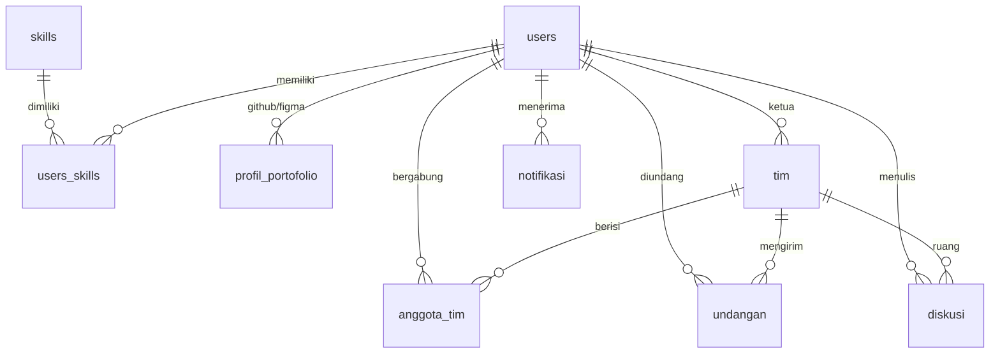

# api-skillmatch

Backend REST API **SkillMatch** — Kelompok 4, SIF125113 Pemrograman Mobile (H6C.3).
Dibangun mengikuti **Modul 2A** (Express + MySQL, struktur berkas Langkah 16) dan **kontrak API Modul 2C**
(respons array langsung, kesalahan `{ "pesan": "..." }`, DELETE → 204 tanpa body). Klien: React Native (Expo), Android.

## Cara menjalankan dari nol
```bash
git clone <url-repo> && cd api-skillmatch
npm install
cp .env.example .env            # isi DB_*, JWT_SECRET (XAMPP: DB_USER=root, DB_PASSWORD kosong)
mysql -u root -p < skema.sql    # atau Import di phpMyAdmin. PERINGATAN: memuat DROP DATABASE db_skillmatch
npm run dev                     # terminal harus menampilkan "Terhubung ke basis data"
```
Akun contoh dari `skema.sql` (password `password123`): `andi@contoh.com`, `bella@contoh.com`, `citra@contoh.com`.

Variabel `.env`: `DB_HOST, DB_PORT, DB_USER, DB_PASSWORD, DB_NAME, PORT, JWT_SECRET, JWT_EXPIRES_IN`,
`GITHUB_TOKEN` (opsional, menaikkan batas GitHub API), `GITHUB_REQUIRE_BIO_PROOF` (`false` untuk development).

**Dari aplikasi Expo** (Modul 2C Langkah 6): emulator Android `http://10.0.2.2:3000`, HP fisik
`http://<IP-LAN-laptop>:3000` (server sudah `listen` di `0.0.0.0`). Contoh `.env` Expo: `EXPO_PUBLIC_API_URL=http://192.168.1.10:3000`.

## Struktur berkas
```
server.js            menyalakan server (0.0.0.0)
app.js               middleware & pendaftaran route
db.js                connection pool mysql2 + uji koneksi + helper transaksi
skema.sql            9 tabel + data awal (25 skill, 3 akun contoh, 1 tim contoh)
routes/              auth.js  users.js  skills.js  portofolio.js  tim.js  undangan.js  notifikasi.js
middleware/auth.js   verifikasi JWT (Authorization: Bearer <token>)
services/            profil, verifikasi skill, notifikasi, klien GitHub & Figma API
utils/               http.js (error seragam), validasi.js
test/api.test.js     uji integrasi    postman/   koleksi Postman (35 request)
```
Modul sesuai bagian 2.3 dokumen: **M1** `auth, users, skills, notifikasi` · **M2** `portofolio` · **M3** `tim, undangan`.

## Diagram relasi (6.2) — 9 entitas

`BOOKMARKS` tidak ada: US-08 berstatus *Won't* (di luar ruang lingkup).

## Kontrak respons
| Situasi | Status | Body |
|---|---|---|
| GET daftar | 200 | **array langsung** (bukan `{data: []}`) |
| GET detail / PUT | 200 / 404 | objek / `{pesan}` |
| POST | 201 | objek ringkas berisi id |
| DELETE | 204 | **tanpa body** |
| Validasi gagal, id bukan angka | 400 | `{pesan}` |
| Tanpa/salah token | 401 | `{pesan}` |
| Bukan ketua/anggota | 403 | `{pesan}` |
| Tidak ditemukan | 404 | `{pesan}` |
| Duplikat / sudah direspons | 409 | `{pesan}` |
| Kegagalan database | 500 | `{ "pesan": "Operasi database gagal" }` (server tetap hidup) |

Pencarian mengembalikan total baris di header `X-Total-Count`; notifikasi mengembalikan `X-Belum-Dibaca`.
Semua endpoint selain `/`, `/auth/register`, `/auth/login`, `/skills*` memerlukan `Authorization: Bearer <token>`.

## Daftar endpoint
| Metode | Jalur | Body / query contoh | Respons sukses | US |
|---|---|---|---|---|
| POST | /auth/register | `{nama,email,password,peran_utama}` | 201 `{id_users,nama,email,peran_utama,token}` | 01 |
| POST | /auth/login | `{email,password}` | 200 `{token,user}` | 01 |
| GET | /auth/me | – | 200 profil lengkap | |
| GET | /users/me | – | 200 profil sendiri | 01 |
| PUT | /users/me | `{nama,bio,peran_utama,ketersediaan}` | 200 profil | 01 |
| PUT | /users/me/skills | `{"skill_ids":[1,14,16]}` | 200 array skill + `status_verifikasi` | 01, 11 |
| GET | /users/search | `?skill=Figma,JavaScript&peran=&tersedia=true&verified=true&q=&page=&limit=` | 200 array kandidat | 04 |
| GET | /users/:id | – | 200 profil publik + github + figma | 07, 11 |
| GET | /skills | `?kategori=desain` | 200 array `{id,nama,kategori}` | 01 |
| GET | /skills/statistik | – | 200 array (COUNT & SUM per skill) | |
| GET | /notifikasi | `?belum_dibaca=true` | 200 array | 10 |
| PUT | /notifikasi/:id/baca · /notifikasi/baca-semua | – | 200 | 10 |
| GET | /portofolio | – | 200 `{github,figma}` | |
| GET | /portofolio/github/challenge | – | 200 `{kode,petunjuk}` | 02 |
| POST | /portofolio/github | `{"username":"octocat"}` | 201 ringkasan | 02 |
| POST | /portofolio/github/sinkron | – | 200 | 02 |
| GET | /portofolio/github | – | 200 `{jumlah_repo,jumlah_commit,top_languages}` / 404 | 07 |
| POST | /portofolio/figma | `{token,file_keys:[..]}` | 201 | 03 |
| GET | /portofolio/figma | – | 200 / 404 | 03 |
| DELETE | /portofolio/github · /portofolio/figma | – | 204 / 404 | |
| POST | /tim | `{nama_tim,deskripsi,kebutuhan_skill:[..]}` | 201 `{id_tim,nama_tim}` | |
| GET | /tim | – | 200 array (+ `peran_saya`, `jumlah_anggota`) | |
| GET | /tim/:id | – | 200 `{...tim,anggota,undangan}` | |
| PUT | /tim/:id | `{nama_tim,deskripsi,kebutuhan_skill}` | 200 | |
| DELETE | /tim/:id | – | 204 | |
| POST | /tim/:id/undangan | `{id_users,peran_ditawarkan}` | 201 `{id_undangan,status}` | 05 |
| PUT | /tim/:id/anggota/:id_users | `{peran}` | 200 | |
| DELETE | /tim/:id/anggota/:id_users | – | 204 | |
| GET | /undangan | `?status=menunggu` | 200 array | 06 |
| PUT | /undangan/:id | `{"status":"diterima"}` / `ditolak` | 200 | 06 |
| GET | /tim/:id/diskusi | `?setelah_id=12&limit=50` | 200 array (lama → baru) | 09 |
| POST | /tim/:id/diskusi | `{isi_pesan}` | 201 | 09 |

## Pemenuhan daftar periksa Modul 2A
- ESM (`"type": "module"`), skrip `dev`, `.env` & `node_modules` di `.gitignore`, `.env.example` di repositori.
- Semua kueri memakai **prepared statement** (`?`); tidak ada nilai ditempel lewat template string.
- JOIN dipakai di pencarian, detail tim, undangan; **agregasi** (COUNT/SUM) di `/skills/statistik` dan `jumlah_anggota`.
- Setiap handler dibungkus `try/catch` melalui `tangani()` di `utils/http.js`; kegagalan database → 500 JSON.
- Transaksi (`db.js → transaksi`) untuk buat tim, ganti tag skill, simpan portofolio, dan respons undangan.
- Validasi backend: teks kosong/spasi, batas panjang, id non-angka, enum, duplikat, hak akses ketua/anggota.

## Keputusan desain
- **Verifikasi skill (US-11):** skill pemrograman `terverifikasi` bila bahasanya ada di repo GitHub; skill desain bila ada file Figma yang bisa diakses. Dihitung ulang tiap connect/sinkron/putus/ubah skill.
- **Bukti kepemilikan GitHub:** kode dari `/portofolio/github/challenge` ditaruh di bio GitHub sehingga akun orang lain tidak bisa diklaim.
- **Keamanan:** password bcrypt, token Figma dipakai sekali dan **tidak disimpan**, email tidak tampil di profil publik, helmet + rate limit.
- **Offline (6.3):** cache & sinkronisasi saat koneksi pulih ada di aplikasi Expo (AsyncStorage/Context). Notifikasi dan chat memakai polling.

## Pengujian
```bash
mysql -u root -p -e "CREATE DATABASE db_skillmatch_test CHARACTER SET utf8mb4"
sed 's/db_skillmatch/db_skillmatch_test/g' skema.sql | mysql -u root -p
DB_NAME=db_skillmatch_test npm test        # Windows PowerShell: $env:DB_NAME="db_skillmatch_test"; npm test
```
Untuk bukti laporan: impor `postman/SkillMatch.postman_collection.json`, jalankan *Login* dulu (token terisi otomatis),
lalu tangkap layar tiap endpoint termasuk kasus 400, 401, 403, dan 404. Uji ketahanan: matikan MySQL lalu panggil `/skills` → 500, server tetap hidup.
